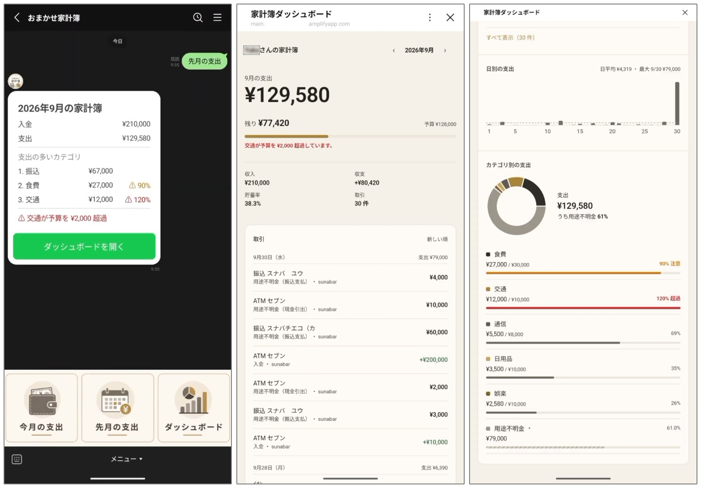
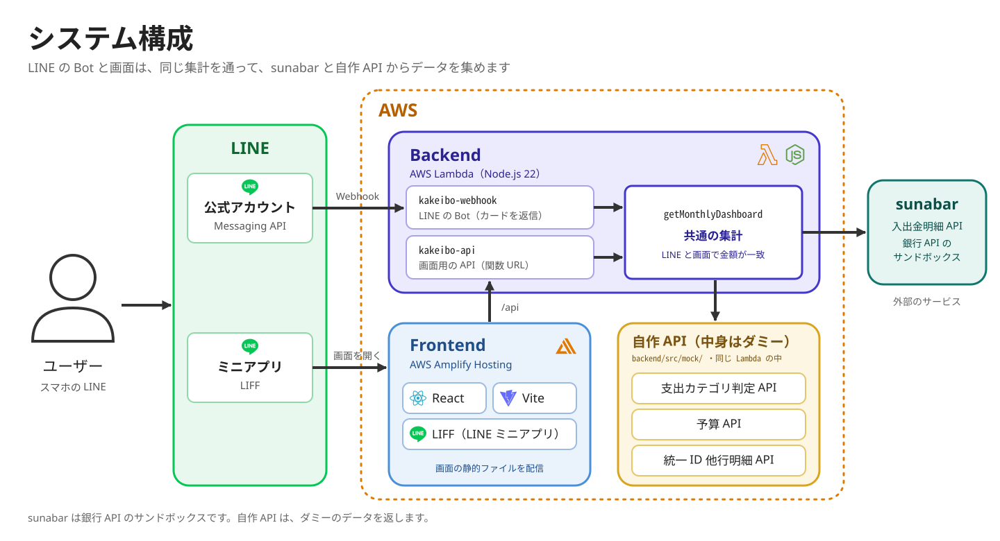

<p align="center">
  
</p>

# おまかせ家計簿

銀行口座の入出金明細を自動で取り込んで支出を分類し、普段使っているLINEの中で確認できる家計簿です。
LINEでボタンを押すか一言送るだけで、何にいくら使ったかが分かります。

> 「sunabar -GMOあおぞらネット銀行API実験場-」を使って、2人のチームで、約4日間で企画から開発まで行いました。



- **左（LINEのカード）**: LINEで「今月の支出」または「先月の支出」と送ると、その月の入金・支出の合計と、支出の多いカテゴリがカードで届く。
- **中央（ダッシュボード）**: カードのボタンまたはリッチメニューからダッシュボードが開く。支出、予算の残り、取引明細を確認できる。
- **右（カテゴリ別の予算）**: カテゴリごとの予算一覧と、その使用率を確認できる。

## 主な機能

| 機能 | 中身 |
| ---- | ---- |
| LINEのサマリー | 「今月の支出」「先月の支出」と送ると、入金・支出の合計と、支出の多いカテゴリ上位3つがカードで届く。 |
| ダッシュボード | LINEの中で開き、今月の支出・予算の残り・取引・日別の支出・カテゴリ別の支出を確認できる。月の切り替えと、カテゴリの絞り込みができる。 |
| 予算 | カテゴリごとの予算に対する使用率を表示し、使いすぎ（80%以上 / 100%超）を知らせる。 |
| 統一ID（構想） | sunabarに加えて、他の金融機関（カード・QR決済。ダミー）の明細も合算して表示する。 |

## 構成



- sunabarのトークンはバックエンドだけが持ち、画面（ブラウザ）には渡しません。

## 使った技術

- フロントエンド：React（Vite）、LIFF（LINEミニアプリ）、Recharts
- バックエンド：Node.js 22、`@line/bot-sdk`、標準の`fetch`
- インフラ：AWS Lambda（関数URL）、AWS Amplify Hosting
- テスト：`node --test`（バックエンドの純粋な関数）。フロントエンドは手動で動作確認
- 開発環境：Docker / Docker Compose

## sunabarと自作API

sunabarの入出金明細APIを1本使い、「こんなAPIがあったら良いな」というAPIを自作しました。

| 種類    | API                                              | 役割                                                 |
| ------- | ------------------------------------------------ | ---------------------------------------------------- |
| sunabar | 入出金明細照会（個人口座）               | 月ごとの入出金明細を取得する。                         |
| 自作    | 支出カテゴリ判定API（`/mock/categorize`）       | 明細の摘要から、食費・住居などのカテゴリを判定する。   |
| 自作    | 予算API（`/mock/budget`）                       | カテゴリごとの月の予算を返す。                         |
| 自作    | 統一ID他行明細API（`/mock/unified-accounts`） | 統一IDに紐づく、他の金融機関の明細を返す。 |

仕様は[contracts/api.md](specs/001-kakeibo-dashboard/contracts/api.md)にあります。

### 自作APIで提案したいこと

| 今の問題 | 仮定（提案） | 自作API |
| -------- | ------------ | -------- |
| **情報がばらばら** | **国が発行する統一ID**。1回の同意で、統一IDに紐づくすべての金融機関の明細をまとめて取得できる。 | 統一ID他行明細API |
| **中身が分からない** | **銀行が「使いみち」を返す**。加盟店の情報と結び付けて、明細のカテゴリをAPIで返す。 | 支出カテゴリ判定API |
| **アプリごとに予算を設定する** | **銀行アプリで設定した予算をAPIで取得できる**。 | 予算API |

## 動かし方

必要なもの：Docker、Git。ホストにNode.jsは不要です。

```bash
git clone https://github.com/fumi217/omakase-kakeibo.git
cd omakase-kakeibo
git config core.hooksPath .githooks        # .env やトークンのコミットを止めるフックを有効にする（最初に 1 回だけ）
cp .env.example .env                       # 値は各自で記入する（.env は Git 管理外）
docker compose build
docker compose run --rm backend npm ci     # ロックファイルどおりに入れる
docker compose run --rm frontend npm ci
docker compose up
```

| URL                   | 内容                                                  |
| --------------------- | ----------------------------------------------------- |
| http://localhost:5173 | ダッシュボード（LIFF Mockで、LINEアプリなしで表示） |
| http://localhost:3000 | バックエンド（ダッシュボードAPI・自作API）          |

- sunabarの明細を取るには、自分のsunabarのトークンと口座IDを`.env`に書きます。
- 依存が変わったとき：`docker compose down -v && docker compose build`のあと、上の`npm ci`の2行をもう一度実行します。
- 環境変数の一覧と意味：[plan.md「環境変数」](specs/001-kakeibo-dashboard/plan.md#環境変数)
- LINEのBotとミニアプリまで動かす手順（Lambda / Amplify / LINE）：[quickstart.md](specs/001-kakeibo-dashboard/quickstart.md)
- 統一IDの他行明細（ダミー）も合算するには、`.env`に`UNIFIED_ID_ENABLED=true`を書いて`docker compose up -d backend`（`restart`では`.env`が読み直されない）。

## ドキュメント

仕様 → 計画 → タスク → 実装の順に進めました（[Spec Kit](https://github.com/github/spec-kit)）。

| ファイル                                                     | 内容                           |
| ------------------------------------------------------------ | ------------------------------ |
| [spec.md](specs/001-kakeibo-dashboard/spec.md)               | 作るもの（ユーザーストーリー・要件） |
| [plan.md](specs/001-kakeibo-dashboard/plan.md)               | 構成・分担・環境変数           |
| [data-model.md](specs/001-kakeibo-dashboard/data-model.md)   | データの形                     |
| [contracts/](specs/001-kakeibo-dashboard/contracts/)         | APIとLINE Botの仕様         |
| [research.md](specs/001-kakeibo-dashboard/research.md)       | 技術選定の理由                 |
| [quickstart.md](specs/001-kakeibo-dashboard/quickstart.md)   | 起動・動作確認・デプロイの手順 |
