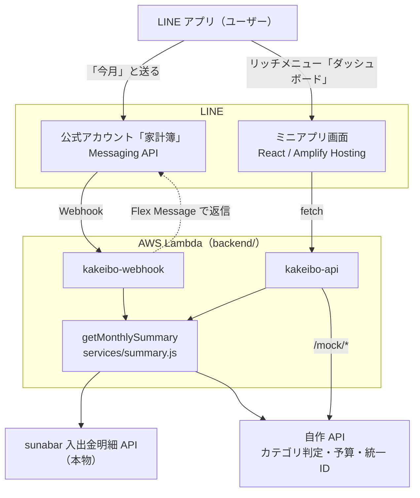

# 家計簿ダッシュボード（sunabar × LINE）

銀行口座の入出金明細を自動で取り込み、支出を自動で分類して、普段使っている LINE の中で確認できる家計簿です。
ユーザーは、LINEでボタンを押すか一言送るだけで、今月いくら何に使ったかが分かります。

section7（Day2〜Day5）のチーム開発で作っています。

## ユーザーから見た流れ

```text
LINE の友だち一覧
 └ 家計簿（公式アカウント）   ← ユーザーが追加するのはこれ1つだけ
     ├ トークで「今月」と送る         → 今月のサマリーが返ってくる（Bot）
     └ 下のメニューの「ダッシュボード」 → LINE の中で画面が開く（ミニアプリ）
```

| 優先度 | できること                                                                                                                  |
| ------ | --------------------------------------------------------------------------------------------------------------------------- |
| P1     | LINE で「今月」「先月」と送ると、入金・支出の合計と、支出の多いカテゴリ上位3つがカードで返る                                |
| P2     | LINE の中でダッシュボードを開き、カテゴリ別の円グラフ・日別の支出・明細一覧を見る。月の切り替えとカテゴリの絞り込みができる |
| P3     | カテゴリごとの予算に対する使用率を表示し、使いすぎ（80% 以上・100% 超）を知らせる                                           |
| P4     | 統一 ID 構想: sunabar に加えて、他の金融機関（ダミー）の明細も合算して表示する                                              |

詳しくは [spec.md](specs/001-kakeibo-dashboard/spec.md) を参照してください。

## sunabarと自作API

sunabar（銀行APIのサンドボックス）を1本以上使い、「こんなAPIがあったら良いな」という APIは自作します。

| 種類    | API                                              | 役割                                                 |
| ------- | ------------------------------------------------ | ---------------------------------------------------- |
| sunabar | sunabar 入出金明細照会（個人口座）               | 月ごとの入出金明細を取得する                         |
| 自作    | 支出カテゴリ判定 API（`/mock/categorize`）       | 明細の摘要から、食費・住居などのカテゴリを判定する   |
| 自作    | 予算 API（`/mock/budget`）                       | カテゴリごとの月の予算を返す                         |
| 自作    | 統一 ID 他行明細 API（`/mock/unified-accounts`） | 統一 ID に紐づく、他の金融機関の明細を返す（ダミー） |

自作 API は `backend/src/mock/` に分けて置き、レスポンスに `x-mock-api: true` ヘッダーを付けて、本物と区別できるようにします。仕様は [contracts/api.md](specs/001-kakeibo-dashboard/contracts/api.md) にあります。

## 構成



- LINE の Bot とダッシュボードは、同じ集計処理（`getMonthlySummary`）の結果を表示します（金額が必ず一致する）。
- sunabar のトークンはバックエンドだけが持ち、画面（ブラウザ）には渡しません。

| 領域           | 技術                                                                      |
| -------------- | ------------------------------------------------------------------------- |
| バックエンド   | Node.js 22、AWS Lambda（関数 URL）、`@line/bot-sdk`、標準の `fetch`       |
| フロントエンド | React、Vite、LIFF（LINE ミニアプリ）、Recharts、AWS Amplify Hosting       |
| 開発環境       | Docker Compose（Node.js 22 = Lambda と同じメジャーバージョン）            |
| テスト         | `node --test`（バックエンドの純粋な関数）。フロントエンドは手動で動作確認 |

## はじめかた

必要なもの: Docker、Git。ホストに Node.js は不要です。

```bash
git clone git@github.com:ms-engineer-bc26-08/yumasuda_section_7.git   # SSH の鍵がない場合は https://github.com/ms-engineer-bc26-08/yumasuda_section_7.git
cd yumasuda_section_7
git config core.hooksPath .githooks        # .env やトークンのコミットを止めるフックを有効にする（最初に 1 回だけ）
cp .env.example .env                       # 値は各自で記入する（.env は Git 管理外）
docker compose build
docker compose run --rm backend npm ci     # ロックファイルどおりに入れる（npm install はロックファイルを書き換えることがある）
docker compose run --rm frontend npm ci
docker compose up
```

| URL                   | 内容                                                  |
| --------------------- | ----------------------------------------------------- |
| http://localhost:5173 | ダッシュボード（LIFF Mock で、LINE アプリなしで表示） |
| http://localhost:3000 | バックエンド（ダッシュボード API・自作 API）          |

- ポート 3000 / 5173 をほかのアプリが使っていると起動できません。先に止めてください。
- 依存が変わったとき（`package.json` が変わる PR を pull したとき）: `docker compose down -v && docker compose build` のあと、上の `npm ci` の 2 行をもう一度実行する
- テスト: `docker compose run --rm backend npm test`
- 環境変数の一覧と意味: [plan.md「環境変数」](specs/001-kakeibo-dashboard/plan.md#環境変数)
- 動作確認・デプロイ（Lambda / Amplify / LINE）の手順: [quickstart.md](specs/001-kakeibo-dashboard/quickstart.md)

## 秘密情報の扱い

- **`.env` は絶対にコミットしない。** トークン類は、ローカルでは `.env`、AWS では Lambda の環境変数だけで扱います。
- トークンや口座番号を、Issue・PR・チャット・スクリーンショットに貼らない。
- 誤って漏れたときは、履歴を消すより先にトークンを再発行する。
- 仕組みでも防いでいます: `.githooks/pre-commit`（人のコミット）、`.claude/`（Claude Code の読み取り禁止とコミット前チェック）。

## 開発の進め方

- 原則: [constitution.md](.specify/memory/constitution.md)
- 仕様 → 計画 → タスク → 実装の順に進めます（Spec Kit）。仕様を変えるときは、コードより先に `specs/` を更新します。
- Git / GitHub のルール: [github-workflow スキル](.claude/skills/github-workflow/SKILL.md)
  - 1 Issue = 1 ブランチ = 1 PR。`main` への直接 push は禁止
  - コミットと PR のタイトルに Issue 番号を入れる（例: `feat(bot): #12 今月のサマリーを返す`）
  - PR の差分は 500 行以内を目安にし、1,000 行を超えない
  - PR を作ったら `@aitutor-review review` とコメントして AI チューターのレビューを受け、チームメンバー 1 名の Approve を得てから Squash and merge

| 担当                         | GitHub         | 範囲                                                                |
| ---------------------------- | -------------- | ------------------------------------------------------------------- |
| A: LINE Bot ＋ 予算          | @fumi217       | P1・P3（sunabar の明細取得・集計、Webhook、Flex Message、予算 API） |
| B: ダッシュボード ＋ 統一 ID | @masuda-yu1019 | P2・P4（React の画面、ミニアプリ、カテゴリ判定 API、統一 ID API）   |

## 本番運用では必要なこと（今回は省略）

講座のルールにより、次の点は実装していません。実際のサービスにするには対応が必要です。

- **本人確認と API の認証**: ダッシュボード API は認証なしで公開しています。本番では、LIFF の ID トークンをバックエンドで検証し、本人のデータだけを返す必要があります。
- **利用者と口座の紐づけ**: 利用者 1 人・sunabar の口座 1 つを前提にしています。LINE のユーザーごとに、別々の口座を安全に紐づける仕組み（トークンの保管を含む）が必要です。
- **トークンの管理**: トークンを Lambda の環境変数に直接置いています。本番では Secrets Manager などで管理し、定期的に更新します。
- **他の金融機関の明細**: 統一 ID と他行の明細はダミーデータです。
- **カテゴリ判定**: 摘要のキーワードで推定しています。銀行が加盟店情報つきの明細を提供すれば正確になる、というのが提案の一つです。
- **ミニアプリの公開**: 開発用の内部チャネルだけを使っています。一般公開には LINE の審査が必要です。

## ドキュメント

| ファイル                                                   | 内容                                                 |
| ---------------------------------------------------------- | ---------------------------------------------------- |
| [spec.md](specs/001-kakeibo-dashboard/spec.md)             | 作るもの（ユーザーストーリー・要件）                 |
| [plan.md](specs/001-kakeibo-dashboard/plan.md)             | 構成・分担・スケジュール・環境変数                   |
| [data-model.md](specs/001-kakeibo-dashboard/data-model.md) | データの形                                           |
| [contracts/](specs/001-kakeibo-dashboard/contracts/)       | API と LINE Bot の仕様                               |
| [tasks.md](specs/001-kakeibo-dashboard/tasks.md)           | タスクの一覧・担当・進め方（コンフリクトを防ぐ約束） |
| [research.md](specs/001-kakeibo-dashboard/research.md)     | 技術選定の理由                                       |
| [quickstart.md](specs/001-kakeibo-dashboard/quickstart.md) | 起動・動作確認・デプロイの手順                       |
| [CLAUDE.md](CLAUDE.md)                                     | Claude Code 向けの前提                               |
